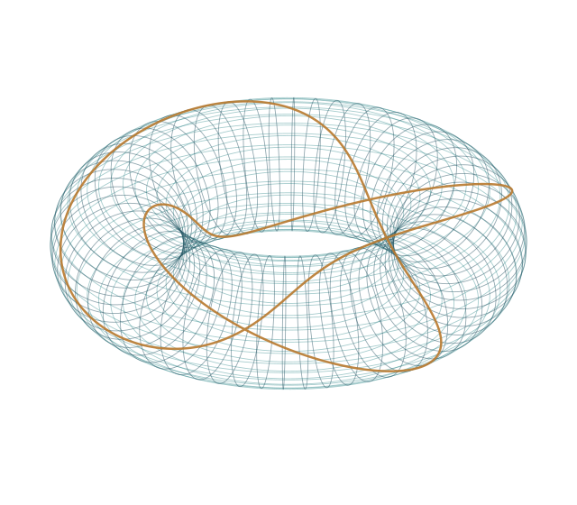

<section class="advisory-hero" aria-labelledby="advisory-title">
  

    
MATHEMATICS × RESEARCH &amp; DEVELOPMENT

    <h1 id="advisory-title">研究開発の難問に、 数学という視点を。</h1>
    
形を捉える。構造を見抜く。 技術の可能性を、根本から考える。

    
微分幾何学と可積分系の研究を背景に、企業の研究開発における数理的な課題を、ともに考えます。

    
<strong>小林 真平</strong>Shimpei Kobayashi 北海道大学 教授 · 微分幾何学・可積分系

    

      <a class="advisory-button" href="collaboration/">企業・研究開発の方へ ↗</a>
      <a class="advisory-text-link" href="profile/" lang="en">Academic profile (English) →</a>
    

  

  <figure class="advisory-figure">
    
    <figcaption>GEOMETRY · STRUCTURE · DYNAMICS 複雑さの中に、数学の構造を探す。</figcaption>
  </figure>
</section>

微分幾何学可積分系離散幾何統計多様体

## 「計算する」の先にある問いへ

数値実験で現象は見えているが、理由がわからない。形状や運動を扱うモデルについて、何を保存し、何を近似すべきか整理したい。技術論文の数理的な前提を、専門家と議論したい。

こうした場面で、数学は問題の見方を変える手がかりになります。専門領域との接点を確かめながら、課題の定式化、理論の検討、次に確かめるべき問いの整理をご一緒します。

## 研究開発との接点

  <section>01
<h3>形状・曲面を、構造から捉える</h3>
曲率、対称性、幾何的な制約。形の背後にある性質を整理し、連続的な理論と離散的な表現の関係を考えます。

相談テーマの例：形状の数理表現、幾何量、離散化の考え方

</section>
  <section>02
<h3>複雑な運動の中に、規則性を探す</h3>
曲線・曲面の変形や非線形方程式を、保存量や対称性の視点から検討します。数値計算の結果を理解するための理論的な手がかりを探ります。

相談テーマの例：非線形モデル、変形・運動、保存構造

</section>
  <section>03
<h3>確率分布を、幾何学として考える</h3>
分布の集合を空間として捉え、その計量や接続、測地線を研究しています。分布間の違いや変化をどう記述するか、理論の側から議論します。

相談テーマの例：統計多様体、分布の幾何、モデルの前提

</section>

[相談テーマと関わり方を詳しく見る →](collaboration.md)

## 理論に立脚した、継続的な議論を

技術顧問・研究アドバイザーとしての継続的な議論、個別テーマの共同研究、技術者・研究者向けの勉強会など、目的に応じた関わり方をご相談いただけます。

課題を共有し、専門分野との接点を見極め、進め方を相談するところから始めます。

## 研究の蓄積

微分幾何学と可積分系を軸に、曲面・調和写像から離散幾何、統計多様体までを研究しています。以下は、その背景となる研究の一部です。

| 研究の軸 | 代表的な研究 |
| --- | --- |
| 幾何構造と方程式 | *A loop group method for affine harmonic maps into Lie groups*, **Advances in Mathematics** 298 (2016), 207–253. |
| 連続と離散の幾何 | *Discrete constant mean curvature surfaces on general graphs*, **Geometriae Dedicata** 216 (2022), Paper 71. |
| 確率分布の幾何 | *A characterization of the alpha-connections on the statistical manifold of multivariate normal distributions*, **Osaka Journal of Mathematics** 62 (2025), 329–349. |

[代表論文とリンク](publications/selected.md) · [全論文一覧](publications/complete-list.md) · [研究紹介・数理デモ（English）](profile.md)

著書：[**『曲面とベクトル解析』**](https://www.amazon.co.jp/dp/4535806373)

  
LET’S THINK TOGETHER

  <h2>まだ、数式になっていない課題から。</h2>
  
ご所属と課題の概要、ご希望の関わり方をお知らせください。 専門領域との接点を確認し、検討の進め方をご相談します。

  <a class="advisory-button" href="mailto:shimpei@math.sci.hokudai.ac.jp?subject=企業連携・技術顧問のご相談">研究開発・技術顧問の相談 ↗</a>
  
shimpei@math.sci.hokudai.ac.jp

## Academic research &amp; education

I am a professor of mathematics at Hokkaido University, working on differential geometry and integrable systems. My research includes surface theory, harmonic maps, loop group methods, discrete differential geometry, and statistical and affine geometry.

[Research](research/index.md) · [Publications](publications/index.md) · [For prospective students](students/index.md) · [Talks](talks/index.md) · [Contact](contact.md)
